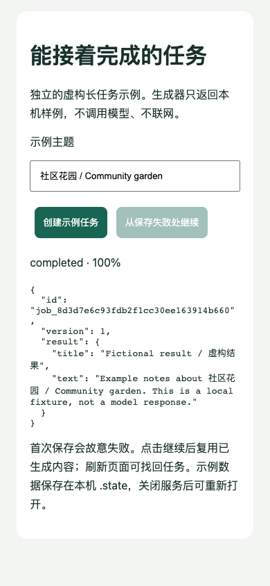

# 小程序 AI 长任务示例



[English](README.md) · Apache-2.0 · Node.js 22.12+

一个可运行的通用示例：只创建一次任务，读取精简进度，保存已生成内容，后续保存
失败时继续，并在重开页面后取回固定版本结果。默认生成器明确使用本机虚构数据，
不调用模型、账号、密钥或云服务。

```sh
npm test
npm run demo
npm start
```

打开 `http://127.0.0.1:4198`。创建任务后，生成成功、首次保存故意失败；点击继续，
复用已生成内容并完成保存，刷新页面仍可取回。同一主题保留请求标识，响应丢失后
再次提交不会另建任务；修改主题可创建另一项。无须安装运行依赖。

## 原生小程序

用自己的独立测试 AppID 导入 `miniprogram/`，仓库 AppID 留空。不借用其他项目身份。
后端在本机启动；`127.0.0.1` 仅供本机开发，手机不能通过它连接这台电脑。遵循微信
正常开发配置和权限；真机或线上使用前需接入有认证、授权的 HTTPS 后端。

页面在请求前保存意图，显示时恢复最近任务，隐藏/卸载时停止轮询；临时轮询失败
限次退避，完成后才取全文。专项只模拟 SDK 生命周期，不代表开发工具和真机验收。

## 恢复与隐私边界

- 创建接口按请求标识和输入去重，同标识不同输入报冲突；重复创建不重置重试次数。
  继续操作是显式请求。进度接口不带生成正文，结果接口要求已完成并读取已存版本。
- 生成、保存分别持久化；演示失败发生在生成结果已保存之后。若生成器执行期间
  崩溃，仍可能重跑；真实模型、支付和外部写入需要接收端幂等。重命名不保证断电持久性。
- `.state/` 含输入和结果，仅供本机、默认忽略，不可公开。演示只用虚构内容，不把
  凭据放进输入或结果。服务没有生产认证，只能绑定本机回环地址。
- `TaskService(directory, {generate})` 可注入自有异步生成函数；没有内置供应商、
  生产数据库、公开部署、分布式 worker、自动抢锁或无限重试。旧锁需核对原进程
  已停止后再人工恢复，不能按任意超时自动删除。

共享运行器来自 Apache-2.0 的 [Agent Task Recovery Kit](https://github.com/workstonedai-collab/agent-task-recovery-kit)，
保留原许可和归属。独立新历史，无私有产品结构、内部提示词或真实资料。
本轮验证为 Node 服务/HTTP 恢复与小程序模拟生命周期；真实模型、浏览器使用和真机另行验收。
